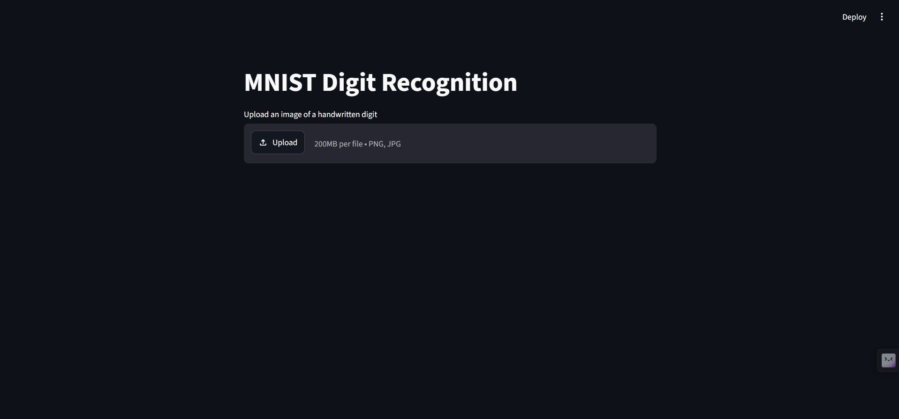
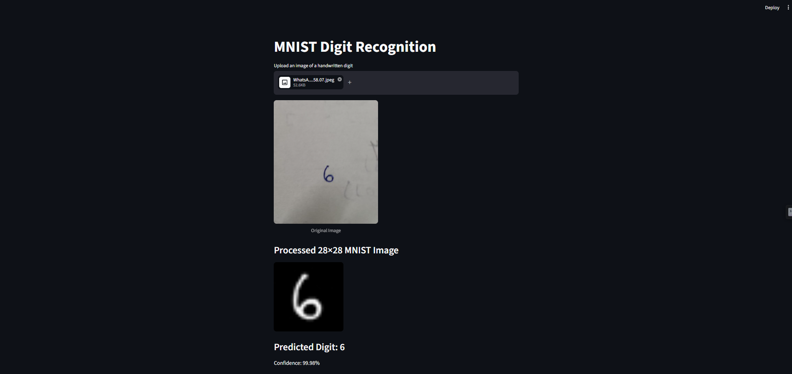

# ✍️ Handwritten Digit Classification using CNN

A deep learning project that recognizes handwritten digits (0–9) using a **Convolutional Neural Network (CNN)** built with TensorFlow and Keras. The project includes an interactive Streamlit web application for making predictions from uploaded images.

## 📌 Project Overview

The model is trained on the MNIST handwritten digit dataset. It learns patterns from image pixels and predicts the digit present in an image.

## ✨ Features

- 🔢 Handwritten digit recognition (0–9)
- 🧠 CNN model built using TensorFlow and Keras
- 🖼️ Image preprocessing for model input
- 📊 Prediction confidence score
- 🌐 Interactive Streamlit web interface
- 💾 Saved model for predictions without retraining

## 🛠️ Technologies Used

- 🐍 Python
- 🧠 TensorFlow and Keras
- 🔢 NumPy and Pandas
- 📈 Matplotlib
- 🌐 Streamlit
- 📓 Jupyter Notebook

## 🏗️ Model Architecture

The CNN contains the following layers:

1. **Conv2D:** 32 filters with ReLU activation
2. **MaxPooling2D:** Reduces spatial dimensions
3. **Conv2D:** 64 filters with ReLU activation
4. **MaxPooling2D:** Further reduces spatial dimensions
5. **Flatten:** Converts feature maps into a one-dimensional vector
6. **Dense:** 128 neurons with ReLU activation
7. **Dropout:** Rate of 0.5 to help reduce overfitting
8. **Output Layer:** 10 neurons with Softmax activation for digit classification

⚙️ **Optimizer:** Adam  
📉 **Loss Function:** Categorical Cross-Entropy

## 📊 Model Performance

| Model | Test Accuracy |
|---|---:|
| 🧠 CNN | **98.76%** |
| 🔹 ANN | 95.97% |
| 🔸 Simple Perceptron | 88.08% |

🏆 The CNN achieved **98.76% test accuracy** in the recorded evaluation.

## 🖥️ Application Screenshots

### 🏠 Home Interface



### 🔍 Digit Prediction



## 📂 Project Structure

```text
MNIST_CNN_Project/
├── app.py
├── MNIST_CNN_Training.ipynb
├── mnist_cnn_model.h5
├── README.md
├── app_home.png
└── digit_prediction.png
```

## 🚀 Installation and Usage

### 1️⃣ Install the Required Libraries

Make sure Python is installed, then open a terminal in your project folder and run:

```bash
pip install streamlit tensorflow pillow numpy
```

### 2️⃣ Run the Streamlit Application

Run the following command from your project folder:

```bash
streamlit run app.py
```

### 3️⃣ Use the Application

🌐 The application will open in your browser.

- 📤 Upload an image of a handwritten digit.
- 🔍 The CNN model processes the image and predicts the digit.
- 📊 View the predicted digit and its confidence score.

## 📓 Training Notebook

The `MNIST_CNN_Training.ipynb` notebook contains the model training process.

📌 **Note:** The notebook requires the MNIST CSV dataset files in the expected location if you want to train the model again. The Streamlit application loads the saved model and does not retrain it for every prediction.

## 👩‍💻 Author

**Ayushi Srivastava**
